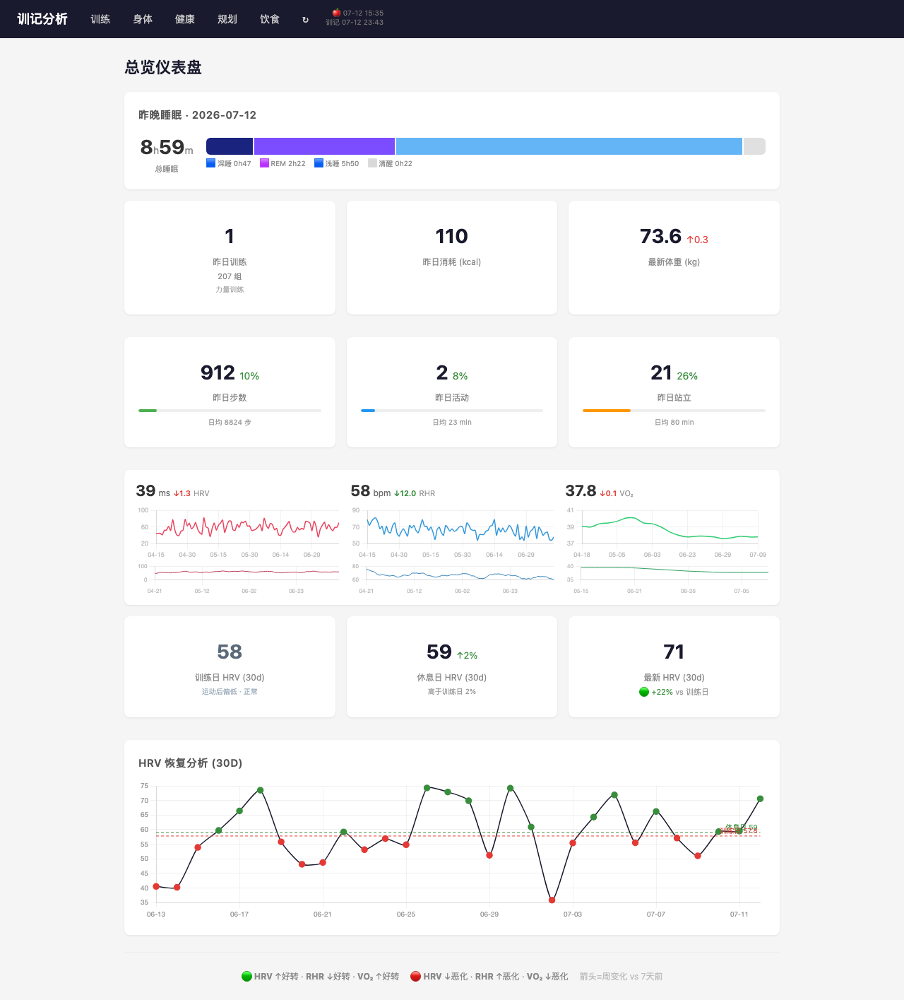

<p align="center">
  
</p>
<p align="center"><sub>截图摄于饮食模块停用前；当前导航不再提供饮食入口。</sub></p>

<p align="center">
  <a href="LICENSE"></a>
  <a href="https://www.python.org/"></a>
  <a href="https://github.com/Ross98/XunJi/releases/tag/v2.0"></a>
</p>

# 寻迹 · 训记数据分析面板

基于 [训记](https://xunjiapp.cn) Open API + Apple Health 的个人健身数据分析仪表盘。当前界面专为桌面浏览器（PC/Mac）设计，不提供手机端适配。

## v2.0 新功能

### Apple Health 集成
- 导入 Apple Health 导出数据（支持 59 种指标类型、9 种训练类型）
- 流式解析 1.3GB+ XML，逐批写入 SQLite 缓存
- 支持增量重复导入（`INSERT OR IGNORE`）
- 后台导入、进度状态与页面刷新后状态恢复

### 健康仪表盘
- **恢复指标** — HRV、静息心率、VO₂Max、血氧、呼吸率与一分钟心率恢复
- **活动与睡眠** — 步数、活动分钟、站立时间、睡眠阶段与腕温
- **步态指标** — 步速、步幅、步态不对称与步行稳定性
- **趋势图表** — HRV / 静息心率 / VO₂Max 原始值与 7 日均线

### 恢复分析
- 训练日 vs 休息日的 HRV 对比
- 14 天 HRV 趋势图（训练日红色标记）
- 自动从训记 API + Apple Watch 合并训练计数

### 身体数据融合
- Apple Health 体重/体脂自动补充训记 API 空白日期
- 每项显示实际测量日期与数据来源
- 体重/体脂趋势切换、完整历史记录、CSV 导出与左右围度差异

### 训练计划增强
- 基于 Apple Health 恢复状态（HRV / 静息心率）的强度建议
- 动作分类：推/拉/腿/核心/有氧 自动归类
- 训练部位缺口与训练间隔可视化
- 支持目标、每周天数、单次时长、器械与伤病限制偏好
- 输出可解释的今日处方和未来 7 天训练/恢复安排

### 睡眠分析
- Apple Health 睡眠阶段导入（核心/深度/REM）
- 睡眠阶段分布图表（深睡/REM/浅睡/清醒）
- 连续阶段按结束日归档、重叠时段去重；来源冲突明确标记，完整时长未确认时不用于恢复评分

### 桌面端体验与安全退出
- 当前导航高亮、数据更新时间、新鲜度提示与手动刷新反馈
- 浅色、深色和跟随系统三种主题
- 导航栏“退出项目”提供二次确认
- 确认退出后停止后台任务、关闭 HTTP 客户端与 Uvicorn 服务，并释放端口
- 退出接口仅允许本机请求；浏览器若阻止自动关页，会保留“项目已关闭”提示页

## 功能清单

| 模块 | 功能 |
| --- | --- |
| **今日概览** | 训练摘要、身体数据、活动指标、睡眠、健康趋势与恢复分析 |
| **训练记录** | 30/90 天容量和趋势、动作 PR/1RM、频率热力图、日历与单日详情 |
| **身体数据** | 体重/体脂/BMI 趋势、来源、左右差异、完整历史与 CSV 导出 |
| **健康数据** | 恢复、睡眠、腕温、血氧、呼吸、步态、训练记录与后台数据管理 |
| **训练计划** | 可配置偏好、恢复评分、动作处方、训练分布与未来 7 天安排 |

## 快速开始

### 1. 配置 API Key

从训记 App → 设置 → Open API 获取密钥，创建 `.env`：

```bash
cp .env.example .env   # 或手动创建
```

| 变量 | 说明 |
| --- | --- |
| `XUNJI_API_KEY` | 训练数据 API Key |
| `XUNJI_BODY_API_KEY` | 身体数据 API Key |

`.env` 会在应用启动时自动加载。饮食模块已经停用，不再需要饮食相关 API Key。

### 2. 导入 Apple Health 数据

推荐使用 Hozz 自动同步：在 iPhone 中将 NDJSON 自动导出目标设为 iCloud 云盘的
`Apple Health` 文件夹。循迹运行期间每 60 秒检查一次新批次，健康页面也提供
“立即同步 Hozz”按钮。可通过环境变量 `XUNJI_HEALTH_SYNC_DIR` 改为其他目录。
进程须有该目录的 macOS 读取权限，iCloud 文件须可下载到本机；手机后台执行
由 iOS 决定，不保证实时同步。循迹退出后不继续检查。
关闭期间的新批次会留在 iCloud，下次启动时自动补导。健康页分别显示当前自动检查
是否运行、最近检查时间和数据日期；超过三分钟未检查会标为过期，历史成功不代表当前仍在同步。

首次接入前自动备份现有健康 SQLite 数据库。原始 Hozz 记录按 ID 保存，重复批次
不会重复累计，删除记录保留墓碑以阻止旧批次复活。测量、分类和训练记录投影到
现有页面；未支持的类型及旧库时间键冲突保留原始记录，并在页面显示数量。
旧 XML 记录没有 HealthKit ID，无法可靠判断删除归属，因此 Hozz 删除不会移除
既有 XML 记录。同步覆盖状态独立显示，未完成类型的最新接收日期不代表完整数据。
损坏或未下载完成的批次整批回滚，下次检查重试，其他有效批次仍可导入。

旧 XML 导入仍可使用：
从 iPhone：设置 → 健康 → 导出所有健康数据 → 解压到 `Apple Health/apple_health_export/`
然后在 `/health` 页面点击"开始导入"（首次约 2-5 分钟）

### 3. 本地运行

```bash
python3.11 -m venv .venv
source .venv/bin/activate
python -m pip install -r requirements.txt
python -m uvicorn app:app --reload --host 127.0.0.1
```

打开 http://localhost:8000

使用完毕后，点击导航栏右侧的“退出项目”，再点击“确认退出并关闭”。应用会优雅停止本地服务并释放占用的端口；无需回到终端手动结束 Uvicorn。

### 4. Docker

```bash
docker build -t xunji .
docker run -p 127.0.0.1:8000:8000 --env-file .env xunji
```

## 项目结构

```
├── app.py                  # FastAPI 入口
├── app_state.py            # 全局状态
├── config.py               # 配置
├── api_client.py           # 训记 API HTTP 客户端
├── cache.py                # SQLite 缓存层
├── data_service.py         # 数据服务（缓存+API 读写）
├── analysis.py             # 数据分析函数
├── movements_cn.py         # 训练类型/动作中英文映射
├── apple_health.py          # Apple Health 导入 & 查询引擎
├── planner.py              # 训练计划生成器
├── shutdown_service.py      # 本地服务优雅退出调度
├── routes/                 # 路由模块
│   ├── dashboard.py        # 仪表盘
│   ├── training.py         # 训练记录
│   ├── diet.py             # 已停用的饮食模块（仅保留历史代码）
│   ├── body.py             # 身体数据
│   ├── health.py           # Apple Health 数据
│   └── plan.py             # 训练计划
├── templates/              # Jinja2 模板
├── static/                 # 样式、图标与 Web App Manifest
├── tests/                  # 单元测试
└── Dockerfile
```

## 技术栈

- **后端** — Python 3.11+, FastAPI, uvicorn
- **模板** — Jinja2, HTML, Chart.js
- **数据** — SQLite（Apple Health 缓存）, httpx（API）, pandas（分析）
- **测试** — pytest
- **部署** — Docker

## 数据

- **xunji_cache.sqlite** — 训记 API 响应缓存（训练空结果会按策略重新验证）
- **apple_health_cache.sqlite** — Apple Health 数据缓存（一次性导入）

## 运行范围

这是只考虑 PC/Mac 桌面浏览器的个人本地应用。管理和导入接口没有用户账户体系，请只监听本机地址；如需跨设备或公网访问，应先在反向代理层增加认证和 HTTPS。

`/admin/shutdown` 只接受环回地址请求，并要求界面发送专用确认头。使用 `uvicorn --reload` 时，退出逻辑会关闭重载监督进程，避免服务被自动重新拉起。

点击退出后会拒绝新页面请求，取消并等待正在运行的页面请求和刷新，然后结束服务并清理同步任务；等待接口或分页不会再拖住退出。

## 已停用模块

饮食数据依赖人工估算，当前不参与任何页面、统计或启动配置。相关路由、模板、分析函数和历史设计文档仅作为旧实现存档，不会在应用中注册。

## 资料

- [训记官方动作中文名表](./docs/Xunji-movements.md)
- [训记 App](https://xunjiapp.cn) — iOS/Android
